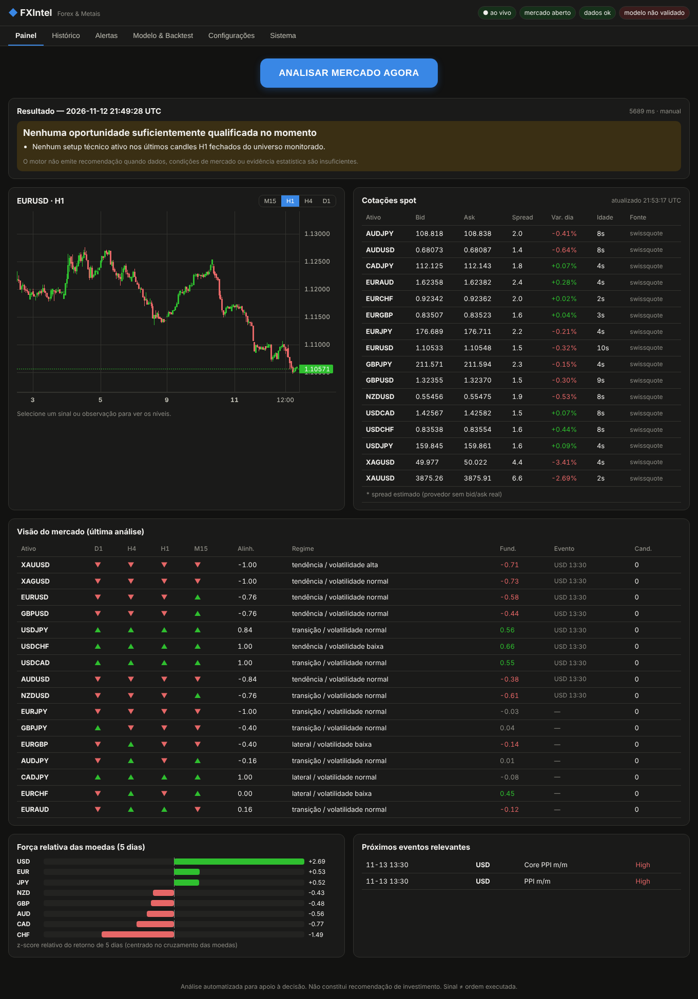

# FXIntel — Motor de Inteligência de Mercado para Forex e Metais

Plataforma que integra **análise técnica multi-timeframe e estrutural (BOS/CHoCH, FVG, Order Blocks,
liquidez)**, **análise fundamentalista/intermercados**, **modelagem quantitativa com validação walk-forward**
e **gestão de risco**, com backend HTTP/WebSocket, painel web e **aplicativo Android**. Foco em XAU/USD,
XAG/USD e 14 pares de moedas.

**Sem chave de API e sem servidor obrigatório:** o app Android roda o motor completo no próprio celular,
buscando dados direto de fontes públicas: **Swissquote** (bid/ask reais de FX e metais), TrueFX (checagem
cruzada), Yahoo Finance (histórico), gold-api.com e o calendário ForexFactory. O servidor Python é opcional
(painel web, backtest, retreino) e também não exige chave por padrão.

Ao receber o comando **ANALISAR MERCADO AGORA**, o motor faz o seguinte:

1. Coleta cotações spot (bid/ask, spread, horário e idade).
2. Processa os dados técnicos, fundamentalistas e quantitativos de todos os instrumentos.
3. Avalia cada oportunidade candidata em 14 portões de qualidade e risco.
4. Apresenta a mais bem classificada **ou informa expressamente que não há oportunidade suficientemente
   qualificada**.

> ### Situação atual, sem maquiagem
> O backtest walk-forward com dados reais e custos (≈13 mil candidatos, 16 instrumentos, jan/2024–nov/2026)
> **não encontrou vantagem estatística robusta**. Os setups têm expectativa bruta ≈ 0 e líquida ≈ −0,19R. O
> modelo probabilístico não supera a taxa-base fora da amostra no período completo (BSS −0,006). Por isso, na
> configuração padrão, **o motor bloqueia sinais** e mostra os candidatos apenas como observações, com os motivos.
> É o comportamento exigido pela especificação. Detalhes em
> [docs/LIMITACOES-E-RISCOS.md](docs/LIMITACOES-E-RISCOS.md) e no
> [relatório de backtest](reports/RELATORIO-BACKTEST-2026-11-12.md).



## Entregáveis

| # | Entregável | Onde |
|---|---|---|
| 1 | Motor analítico integrado | `fxintel/` · [Arquitetura](docs/ARQUITETURA.md) · [Metodologia](docs/METODOLOGIA.md) |
| 2 | Backend com APIs (REST + WebSocket) | `backend/` · [API](docs/API.md) |
| 3 | Aplicativo Android (fonte + APK), **autônomo** | `android/` · **`releases/FXIntel-1.1.0.apk`** · [Android](docs/ANDROID.md) |
| 4 | Painel interativo | `dashboard/` (servido em `/` pelo backend) |
| 5 | Classificação, validação e gestão de risco | `fxintel/engine.py`, `fxintel/risk/`, `fxintel/execution/` |
| 6 | Relatórios de testes e avaliação quantitativa | [docs/TESTES.md](docs/TESTES.md) · `reports/` |
| 7 | Documentação, instalação, configuração e uso | [docs/INSTALACAO.md](docs/INSTALACAO.md) · [Limitações e riscos](docs/LIMITACOES-E-RISCOS.md) |

## Início rápido

```bash
pip install -r requirements.txt
python -m fxintel train      # dados históricos + walk-forward + modelo + relatório (3–6 min)
python -m fxintel serve      # API + painel em http://localhost:8000 (sem chave por padrão)
python -m fxintel analyze    # análise no terminal
python -m pytest             # 22 testes offline
```

Docker: `cd deploy && docker compose up -d --build` (HTTPS opcional com Caddy).
**Android: instale o APK e toque em ANALISAR MERCADO AGORA. Nada a configurar.**

## Estrutura

```
fxintel/        motor: data · technical · fundamental · quant · signals · risk · execution · backtest · engine
backend/        FastAPI (REST, WebSocket, autenticação, tarefas de fundo)
dashboard/      painel web (HTML/CSS/JS)
android/        app Kotlin + Jetpack Compose (motor portado para Kotlin, verificado contra o Python)
config/         settings.example.json · central_banks.json (atualizar após decisões dos BCs)
reports/        relatórios de backtest (Markdown, JSON, gráficos)
deploy/         Dockerfile · docker-compose · Caddyfile · systemd
docs/           documentação técnica
tests/          testes automatizados
releases/       APK instalável
analysis/       scripts e análise manual anteriores (legado, 20/07/2026)
```

## Princípios de projeto

- **Mesmo código no backtest e ao vivo** (quadros técnicos causais, verificados por teste).
- **Probabilidades verificáveis:** a probabilidade exibida é a frequência observada fora da amostra na faixa
  prevista, com IC 90% e *n*, nunca uma confiança declarada.
- **Custos explícitos** (spread por sessão, slippage, gaps; "stop primeiro" em candles ambíguos).
- **Sinal ≠ ordem:** o app não envia ordens. O servidor oferece conta demo local e um conector de corretora
  opcional, desativado por padrão.
- **Mesmos números no celular e no servidor:** o motor Kotlin do app é verificado contra o motor Python por
  testes "golden" (quadro técnico, candidatos, features e probabilidades idênticos sobre os mesmos dados).
- **Preservação de capital primeiro:** limites de perda, exposição por moeda, correlação e bloqueio automático.

---

*Ferramenta de apoio à decisão. Não constitui recomendação de investimento. Nenhuma metodologia garante
rentabilidade ou precisão absoluta.*
