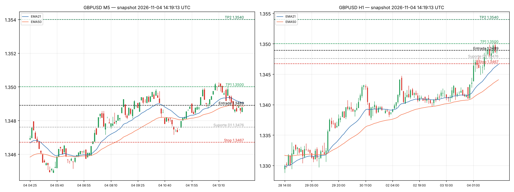

# Análise Forex Spot ao Vivo: quarta-feira, 04/11/2026, 14:19 UTC

**Fontes (só preço bruto, nenhuma análise de terceiros):** cotações bid/ask *streaming*
OANDA (snapshot 14:19:13 UTC) e candles spot Yahoo CCY de M1, M5, H1 e D1 (último candle
14:18:29 UTC). M15 e H4 foram reamostrados localmente. O dia FX conta a partir das 22:00 UTC
(fechamento de NY).
**Universo:** 38 pares, sendo 7 majors, 21 crosses do G8, scandies, PLN, MXN, ZAR, SGD e CNH.

## Sinal

| Campo | Valor |
|---|---|
| **Par** | **GBP/USD** |
| **Direção** | **COMPRA a mercado** |
| **Preço no sinal** | **1.3489** (ask 1.34889 / bid 1.34873, 14:19:13 UTC) |
| **Stop loss** | **1.3467** (−22 pips) |
| **TP1** | **1.3500** (+11 pips): realizar 50% e mover o stop para o breakeven |
| **TP2** | **1.3540** (+51 pips, R:R 2.3) |
| **Saída antecipada** | Fechamento M15 abaixo de 1.3478 (perda do fundo duplo e do suporte D1) |
| **Validade** | Intraday. Se o TP1 não sair antes de ~15:00 UTC, reduzir a posição ou apertar o stop |

## Contexto (medidor de força próprio, 28 crosses do G8)

Variação % média contra os outros 7, no dia FX (desde 22:00 UTC):

**NZD +0.51 > AUD +0.25 > EUR +0.17 > GBP +0.07 > CHF +0.04 > CAD −0.12 > JPY −0.39 > USD −0.51**

- O USD é a moeda mais fraca do dia. O índice sintético do USD caiu 68 bp (de +7.6 às 23:10
  para −60.3 às 13:10).
- Desde 13:10 o USD faz um **repique corretivo de só ~9 bp (≈14% da queda)**. Esse repique
  **parou** na EMA50-M5 do índice: ficou entre −53 e −54 bp por mais de 25 minutos.
- O padrão do dia é risk-on com dólar fraco: AUD e NZD sobem, JPY, CHF e USD caem.

## Por que GBPUSD comprado é a melhor entrada agora

1. **Tendência mais forte entre os majors:** ADX-H1 de 45 (+DI 29 contra −DI 8) e ADX-H4 de 46.
   As EMAs 8, 21 e 50 estão empilhadas para cima em M15, H1 e H4. No D1, o preço está acima de
   todas as EMAs (1.3353 a 1.3393), com RSI-D1 de 65, e já rompeu as máximas de 21/out (1.3418)
   e 29/out (1.3434).
2. **Comprar no recuo, não no topo:** o preço está 14 pips abaixo da máxima do dia (1.35026),
   depois de uma correção em duas pernas.
   - É uma retração de 50–61.8% da última perna (1.34715 → 1.35026).
   - O preço voltou à EMA21-M15 (1.3487), com o RSI-M15 neutro em 53 e o RSI-M5 em 48.
   - A extensão em relação à EMA21-M15 é praticamente zero (≈0 ATR). Não é perseguição de preço.
3. **Correção simétrica e fundo mais alto:** o recuo atual (~18 pips) repete o recuo anterior
   (1.3493 → 1.3472, 21 pips), que foi seguido de nova máxima. Isso forma um **fundo duplo
   1.34847 / 1.34842** logo acima do cluster de suporte D1 1.34762/1.34753 (mínimas de
   ago e set).
4. **Gatilho de retomada:** o histograma MACD-M5 está encolhendo
   (−0.000156 → −0.000136 → −0.000110). Os candles M1 fazem mínimas ascendentes desde 14:13
   (1.34842 → 1.34851 → 1.34871 → 1.34887), e o preço recuperou a EMA21-M15.
5. **Espaço até o alvo:** acima do duplo topo 1.3500/1.3503, a próxima resistência D1 é 1.35446
   (15/jul), cerca de 3.6 ATR-H1. O dia usou 1.38× o ADR de 68 pips, mas o movimento desde a
   abertura é de só +0.83 ADR. Ainda há espaço para expansão.
6. **Spread de 1.6 pips**, cerca de 0.2× o ATR-M15 (7.7 pips). O custo de entrada é baixo.

**Alternativa equivalente:** EURUSD comprado a 1.1259, stop 1.1238, TP1 1.1274 e TP2 1.1298.
Mesma lógica: retração de 50–58% da última perna e reteste da EMA21-M15. Fica em segundo porque
o D1 é baixista (preço abaixo da EMA50-D1 em 1.1320), o par já andou +1.14 ADR desde a abertura
e o ADX-H1 é de 34. **Não operar os dois juntos** (correlação ≈0.9).

## Setups rejeitados (filtro anti-topo, anti-fundo e anti-reversão)

| Par(es) | Setup aparente | Motivo da rejeição |
|---|---|---|
| AUDJPY, NZDJPY, EURJPY, GBPJPY, CADJPY, CHFJPY | Compra (JPY mais fraco) | **Topo do dia** (posição no range de 0.88 a 0.97). RSI-H1 ≥ 64–71, preço 1.4–2.3 ATR acima da EMA21-H1, e AUDJPY e NZDJPY já gastaram ~1.9× o ADR. Comprar aqui seria comprar o topo |
| AUDUSD, NZDUSD | Compra (AUD/NZD fortes) | Perto da máxima e logo abaixo de resistência H1/D1 (0.7025–0.7038 e 0.5645–0.5652). NZDUSD com D1 baixista |
| USDCHF | Venda | Preço em cima do suporte D1 0.8145–0.8156 (topos de ago e set) e de fundo duplo intraday em 0.8146. Seria vender no fundo |
| USDCAD | Venda (reteste do rompimento) | O CAD também está enfraquecendo (−8 bp em 1 h) e empurra o par para cima. O repique ainda está ativo contra a EMA200-D1 (1.3956) e o cluster 1.3963–1.3966. Fundo triplo em 1.3926 |
| USDSGD, USDZAR, USDPLN, EURPLN | Venda (USD fraco) | Na mínima do dia (posição no range ≤ 0.23), ou seja, vender no fundo. Spread largo nos exóticos |
| EURNOK, EURSEK | Compra | Esticados: 1.6 a 2.5 ATR acima da EMA21-M15, RSI-M5 entre 67 e 77, spread de 28 a 33 pips |
| GBPNZD, EURNZD, EURAUD, GBPAUD | Venda (AUD/NZD fortes) | Na mínima do dia, com H4 e D1 contra |
| EURCAD, GBPCAD, EURCHF, GBPCHF, CADCHF, AUDCAD, NZDCAD, AUDCHF, NZDCHF | Variados | Lateralidade (ADX-H1 de 16 a 23 na maioria) e timeframes em conflito, com o preço preso em faixas H1 |
| EURGBP, AUDNZD | — | Sem tendência (ADX-H1 de 12 e 17) |
| USDJPY | Compra | As duas moedas estão fracas, ADX-H1 de 17, resistência em 158.55–158.77 e risco de intervenção perto de 160 |
| USDMXN, USDNOK, USDSEK, USDCNH | Venda | Tendência mista no M5/H1 (repique do USD), spread largo |

## Gestão de risco e caveats

- **Evento:** é provável que o ISM de Serviços dos EUA saia hoje às 15:00 UTC (3º dia útil do
  mês). Proteger a posição antes disso: TP1 ou breakeven. O BoE tende a decidir na quinta 05/11;
  conferir no calendário. Notícia pode invalidar qualquer leitura técnica.
- O stop de 1.3467 fica abaixo da mínima ascendente M15 (1.34715), do suporte D1 1.3475 e da
  EMA21-H1 (1.3466). Perder esse ponto invalida a estrutura de alta intraday.
- Se o TP1 for atingido, o stop vai para o breakeven e a perna até 1.3540 fica sem risco.
- Risco sugerido: ≤ 1% do capital (22 pips de stop). Slippage não foi modelado. Os níveis valem
  para o preço spot do snapshot. Se o preço já estiver acima de 1.3495 na hora da execução, a
  relação risco/retorno até o TP1 piora: esperar o reteste da faixa 1.3485–1.3490.

---
*Análise técnica própria, automatizada, a partir de preço spot ao vivo. Não é recomendação de
investimento. Scripts em `analysis/` (`fx_fetch.py`, `fx_analyze.py`, `fx_chart.py`) e ranking
completo dos 38 pares em `analysis/ranking.csv`.*
