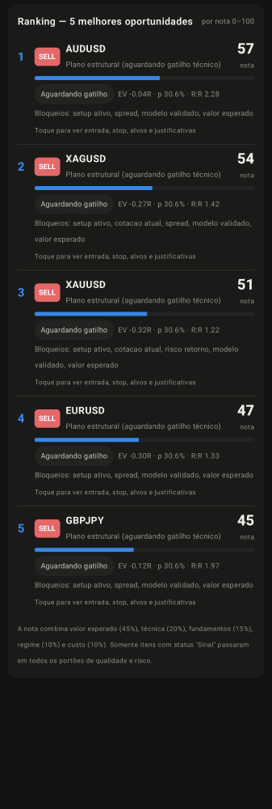
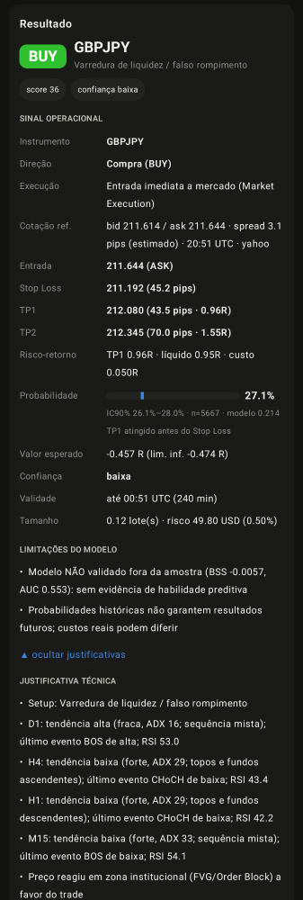
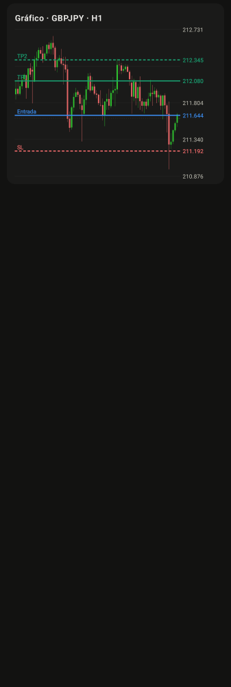

# Aplicativo Android

Aplicativo nativo em **Kotlin + Jetpack Compose (Material 3)**, Android 8.0+ (minSdk 26, targetSdk 35).
APK instalável: `releases/FXIntel-1.2.0.apk`, release assinado, minificado com R8, cerca de 1,75 MB.

## Modo autônomo (padrão): sem servidor e sem chave de API

O motor completo foi portado para Kotlin (`app/src/main/java/com/fxintel/app/engine/`) e roda no aparelho:
indicadores, estrutura BOS/CHoCH, FVG/Order Blocks/liquidez, quadro multi-timeframe, setups, features,
modelo probabilístico com calibração OOS, intermercados, força relativa, viés fundamentalista, eventos,
regime, anomalias, portões e dimensionamento de risco. Os dados vêm direto de fontes públicas:

| Dado | Fonte (sem chave) |
|---|---|
| Cotações bid/ask reais (16 instrumentos) | Swissquote (feed público BBO), perfil de spread "premium" |
| Checagem cruzada de preço | TrueFX (10 pares) e Yahoo |
| Histórico H1/M15/M5 e intermercados | Yahoo Finance (cache em arquivo, atualização incremental) |
| Contingência para ouro/prata | gold-api.com |
| Calendário econômico | ForexFactory/FairEconomy (cache local) |

O modelo (`assets/model.json`) e a tabela de juros (`assets/central_banks.json`) vão embutidos no APK.
Para atualizá-los, rode `python -m fxintel train` (que reescreve `assets/model.json`) e recompile o app.

**Equivalência verificada:** `GoldenEngineTest` executa o motor Kotlin sobre 3.000 barras H1 reais de
EURUSD, USDJPY, XAUUSD e XAGUSD (com intermercados e cesto de moedas) e compara com a saída do motor Python
nos mesmos dados. São 59 colunas técnicas × 400 barras, 599 candidatos, 54 features e todas as
probabilidades, com **zero divergências** (tolerância de 1e-6/1e-5). Um teste de sensibilidade confirmou que
alterações mínimas injetadas no fixture são detectadas.

O histórico e o acompanhamento dos sinais ficam no aparelho. Em segundo plano (WorkManager, a cada 15 min)
o app acompanha os sinais emitidos (TP1/TP2/stop) e avisa sobre eventos críticos, também sem servidor.

O modo servidor continua disponível em **Ajustes → Fonte de dados**, com chave opcional.

| Ranking das 5 melhores (render JVM, dados reais) | Cartão de sinal | Gráfico com Entrada/SL/TP |
|---|---|---|
|  |  |  |

> As imagens acima foram renderizadas na JVM com Paparazzi, a partir de respostas reais do backend. O cartão
> usa uma observação real promovida a "sinal" apenas para exibir todos os campos. Não havia emulador/KVM
> disponível neste ambiente, então o app **não foi executado em um aparelho** durante o desenvolvimento.
> Valide a instalação no seu dispositivo (ver checklist abaixo).

## Funcionalidades

- **Painel:** cotações em tempo real (WebSocket, com fallback para consulta a cada 10 s), botão central
  **ANALISAR MERCADO AGORA**, resultado com a estrutura completa do sinal, barra de probabilidade calibrada com
  IC 90%, justificativas técnicas/fundamentalistas/quantitativas, invalidação, cenários, portões, tamanho da posição
  e execução em conta demo (modo servidor). Também mostra observações não recomendadas, gráfico de candles (M15/H1/H4/D1) com
  linhas de Entrada, SL, TP1 e TP2, visão do mercado (tendências D1/H4/H1, score fundamental, regime, eventos),
  força relativa das moedas e próximos eventos.
- **Ranking:** as 5 melhores oportunidades por nota (0–100), com barra da nota, status (Sinal / Elegível /
  Observação / Aguardando gatilho), EV, probabilidade, R:R e bloqueios; toque para ver entrada, stop, alvos,
  justificativas e o gráfico com os níveis.
- **Histórico:** sinais emitidos com status forward e resultado em R; análises anteriores, que podem ser reabertas no Painel.
- **Alertas:** lista com badge de não lidos; notificações do sistema em tempo real (app aberto) e por
  WorkManager a cada 15 min (app em segundo plano).
- **Ajustes:** fonte de dados (no aparelho / servidor próprio opcional), notificações, instrumentos
  monitorados, capital, risco por trade, perda diária, máximo de posições, EV e R:R mínimos, exigência de modelo
  validado.
  Inclui ainda o painel de **conectividade e integridade**: rede do aparelho, canal de dados, servidor, provedores,
  banco, modelo e última cotação.

## Compilação

Requisitos: JDK 17+ e Android SDK (platform 35, build-tools 35).

```bash
cd android
echo "sdk.dir=/caminho/para/android-sdk" > local.properties
./gradlew assembleDebug                      # app/build/outputs/apk/debug/app-debug.apk
./gradlew testDebugUnitTest                  # parsing, golden Kotlin×Python, snapshots
FXI_LIVE_TEST=1 ./gradlew testDebugUnitTest  # + motor autônomo de ponta a ponta com dados reais (internet)
./gradlew recordPaparazziDebug               # renderiza os componentes (snapshots)
```

Release assinado: crie `android/keystore.properties` (não versionado):

```
storeFile=release.jks
storePassword=…
keyAlias=fxintel
keyPassword=…
```

```bash
keytool -genkeypair -keystore release.jks -alias fxintel -keyalg RSA -keysize 3072 -validity 9125
./gradlew assembleRelease                    # app/build/outputs/apk/release/app-release.apk
```

> A chave que assinou o APK de `releases/` foi gerada no ambiente de build e **não está no repositório**.
> Para publicar atualizações instaláveis por cima, gere sua própria chave e mantenha-a. Um APK assinado com
> outra chave exige desinstalar a versão anterior.

## Checklist de validação no dispositivo

1. Instalar o APK e abrir o app: o Painel abre direto e as cotações aparecem em segundos (selo
   "ao vivo · aparelho").
2. Tocar em ANALISAR MERCADO AGORA: a primeira análise baixa o histórico (de alguns segundos a ~1 min,
   conforme a rede); as seguintes levam poucos segundos.
3. Conferir em Ajustes → Conectividade e integridade que as fontes (swissquote, yahoo, truefx, calendar)
   aparecem como "ok".
4. Tocar numa observação: o gráfico passa a mostrar Entrada, SL e TPs.
5. Desligar o Wi-Fi: o selo muda para "sem rede". Ao religar, a conexão é restabelecida.
6. Conceder permissão de notificações e verificar os alertas (por exemplo, evento econômico próximo).
