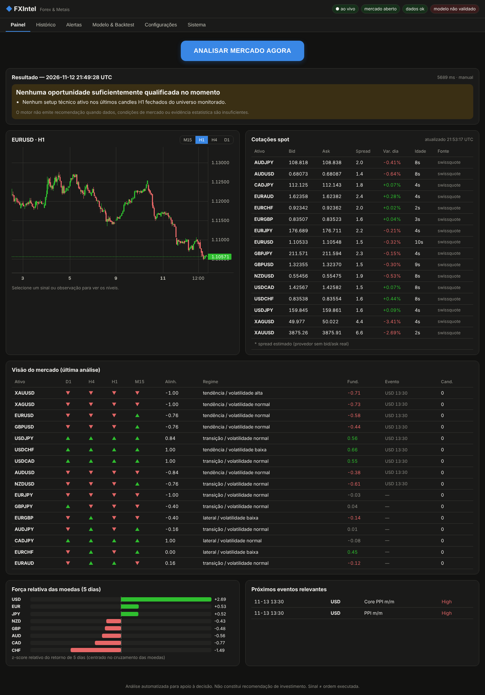

# Relatório de testes e avaliação

Data de execução: 12/11/2026 (ambiente Linux, 4 vCPU, dados reais via internet).

## 1. Testes automatizados

### Python (`python -m pytest`): 22 testes, 22 aprovados

| Área | Testes |
|---|---|
| Técnico | faixas dos indicadores; VWAP exige volume; BOS em tendência sintética; detecção de FVG; **causalidade do quadro MTF** (recalcular com dados truncados reproduz exatamente os valores passados) |
| Execução/rotulagem | stop primeiro em candle ambíguo; parcial no TP1 + breakeven; custos reduzem R; simetria de venda |
| Risco | conversão de moedas, dimensionamento (incluindo bloqueio quando o lote mínimo excede o risco), limites de perda e de posição por instrumento |
| Estatística/modelo | intervalo de Wilson, drawdown, PSR; o modelo **detecta habilidade em dados informativos e não detecta em ruído**; **purging** do walk-forward; limites do portfólio no backtest |
| Dados | parsing Swissquote/TrueFX (fontes sem chave) e OANDA; calendário e bloqueio por eventos (incluindo USD → metais); reparo de saltos de rolagem; ajuste spot dos metais |
| Integração | motor completo **offline** com provedor falso (estrutura do sinal e ausência de sinal sem modelo validado); API **sem chave por padrão** e com chave quando `FXI_REQUIRE_API_KEY=1`, validação de configurações, análise, gráfico e bloqueio de execução real |

Os testes revelaram e corrigiram um erro de arredondamento no dimensionamento (0,0999… lote → 0,09).

### Android (`./gradlew testDebugUnitTest`): 10 testes, todos aprovados

| Teste | O que verifica |
|---|---|
| `ApiParsingTest` (5) | decodificação de respostas reais do servidor (modo servidor) |
| `GoldenEngineTest` (1) | **motor Kotlin = motor Python** sobre 3.000 barras H1 reais × 4 instrumentos: 59 colunas × 400 barras, 599 candidatos, 54 features e probabilidades, com 0 divergências; a injeção proposital de 3 alterações no fixture foi detectada |
| `LiveEngineTest` (1, internet) | motor autônomo com dados públicos reais: 16/16 cotações Swissquote, 0 falhas de fonte; 6,2 s na 1ª análise (download do histórico) e 2,1 s com cache |
| `LocalRepoTest` (1, internet) | modo autônomo de ponta a ponta: cotações, análise, persistência e reabertura, gráfico, saúde, validação de configurações, acompanhamento de sinais e alertas |
| `ScreenshotTest` (2) | renderização JVM (Paparazzi) do cartão de sinal e do gráfico com níveis |

Os testes com internet rodam com `FXI_LIVE_TEST=1` (executados com sucesso em 12/11/2026).

## 2. Latência e confiabilidade (servidor local, 16 instrumentos)

Script: `scripts/benchmark.py` (55 requisições, **0 erros**).

| Operação | p50 | máx. |
|---|---:|---:|
| `GET /health` | 13 ms | 46 ms |
| `GET /quotes` (cache do servidor) | 14 ms | 17 ms |
| Cotações Swissquote (16 instrumentos, paralelo) | ~1 s | — |
| `GET /chart` H1 150 barras | 22 ms | 53 ms |
| `POST /analyze` com cache aquecido (×5) | 2,36 s | 2,40 s |
| `POST /analyze` a frio (1ª da hora) | 20,1 s | — |

Decomposição da análise aquecida: cotações 263 ms, dados 49 ms e cálculo 1,85 s.
Idade das cotações no momento do teste: Swissquote 1–11 s (bid/ask reais); diferença vs. TrueFX ±0,5 pip.
Antes (Yahoo): 17–26 s, sem bid/ask.

## 3. Backtest e validação walk-forward

Relatório completo: [`reports/RELATORIO-BACKTEST-2026-11-12.md`](../reports/RELATORIO-BACKTEST-2026-11-12.md).

| Modelo | Período | n OOS | BSS | AUC | Trades (portfólio) | R médio | PF | Retorno | Máx. DD | Sharpe |
|---|---|---:|---:|---:|---:|---:|---:|---:|---:|---:|
| logística (primário) | desenv. 06/2024–12/2025 | 7.717 | −0,015 | 0,546 | 428 | −0,316 | 0,56 | −49,7% | −50,8% | −4,91 |
| logística (primário) | **holdout 2026** | 4.084 | +0,011 | 0,569 | 66 | +0,095 | 1,17 | +3,0% | −3,1% | 1,22 |
| logística (primário) | completo | 11.801 | −0,006 | 0,553 | 494 | −0,243 | 0,65 | −45,7% | −49,1% | −3,63 |
| gradient boosting | completo | 11.801 | +0,005 | 0,542 | 178 | −0,259 | 0,66 | −20,9% | −22,4% | −3,16 |
| todos os candidatos | completo | 11.801 | — | — | (portfólio) | −0,184 | — | −90,4% | — | — |

- Expectativa bruta (sem custos) de todos os candidatos: −0,040R (IC 90%: −0,059 a −0,021).
- Deflated Sharpe Ratio dos trades selecionados (6 configurações): ≈ 0.
- **Veredito:** sem vantagem estatística e econômica robusta. O modelo não é validado e o motor bloqueia sinais.

Métricas reportadas: Sharpe, Sortino, Calmar, Profit Factor, drawdown máximo e duração, expectativa com
bootstrap (IC 90%), teste t, PSR/DSR, estabilidade (R² da curva de capital), % de meses positivos, retornos
mensais, desempenho por setup, por instrumento e por período, além da tabela de confiabilidade das probabilidades.

## 4. Testes funcionais do painel web

Capturas automatizadas (Playwright) em desktop (1360 px, tema escuro) e celular (390 px, tema claro): ver
`docs/img/painel-*.png`. Sem erros de console, sem rolagem horizontal no celular, WebSocket ao vivo, imagens
do relatório carregando.

## 5. O que NÃO foi testado (e por quê)

| Item | Motivo | Como validar |
|---|---|---|
| App em dispositivo/emulador (interface) | ambiente sem virtualização (KVM); o motor e o repositório do app foram executados na JVM com dados reais | checklist em [ANDROID.md](ANDROID.md) |
| Conector OANDA (opcional, desnecessário) | requer credenciais | — |
| Período de operação em conta demo | requer semanas de mercado | usar "Executar em conta demo" e acompanhar o Histórico |
| Bloqueio por eventos no backtest | sem calendário histórico point-in-time | — |
| Usabilidade com usuários reais | fora do escopo do ambiente | — |
