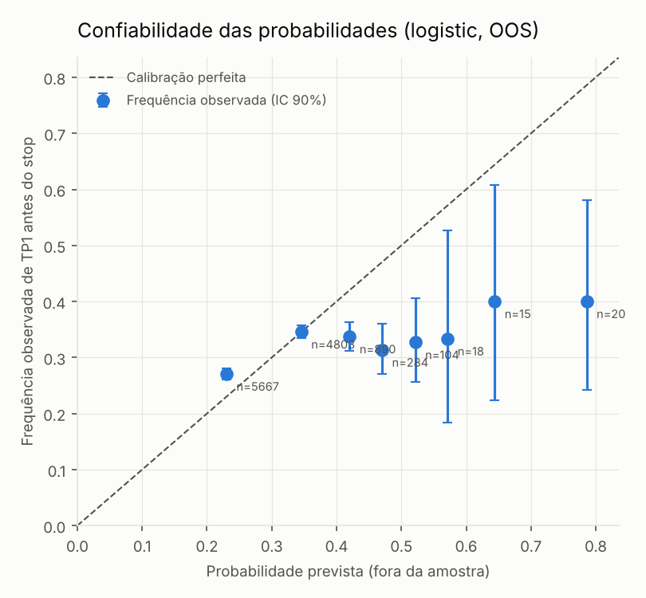
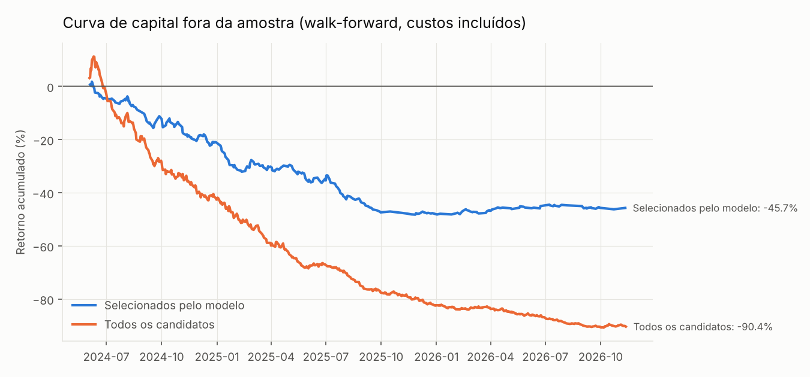

# Relatório de Backtest e Validação Walk-Forward — 2026-11-12

> **Resultados históricos simulados não constituem desempenho comprovado nem garantem resultados futuros.** Todos os números abaixo vêm de dados reais de mercado (Yahoo Finance / proxies documentados), com custos estimados, e foram produzidos pelo próprio código deste repositório (`python -m fxintel train`).

## 1. Conclusão executiva

**O modelo NÃO demonstrou vantagem estatística e econômica robusta fora da amostra.** Regra de validação: BSS OOS > 0.0, AUC OOS >= 0.52 e trades selecionados OOS com R médio > 0 (p < 0,10, n >= 30).

- Candidatos avaliados: **13294** em 16 instrumentos (2024-01-29 a 2026-11-12).
- Expectativa de todos os candidatos: **-0.189 R líquido** (IC90% -0.206 a -0.172); **-0.040 R bruto** (sem spread/slippage).
- Modelo primário (logistic), OOS completo: Brier 0.2145 vs climatologia 0.2133 → **BSS -0.0057**, AUC 0.553.
- Holdout 2026 (nunca usado para decisões de desenho): BSS +0.0114, AUC 0.569, n=4084.
- Holdout 2026, trades selecionados: n=70, R médio +0.185 (p-valor média>0 = 0.128); portfólio 66 trades, retorno +3.0%, PF 1.17; vs. seleção aleatória p=0.014. Sinal positivo, porém amostra pequena, não significativo na média e contrário ao período de desenvolvimento — insuficiente para validar o modelo.
- Trades selecionados pelo portão de EV: n=600, R médio -0.238, p-valor (média>0) 1.000.
- Seleção aleatória com o mesmo nº de trades/mês: R médio -0.182 → p-valor do filtro do modelo = 0.870 (valores altos = filtro não agrega valor).
- Deflated Sharpe Ratio (6 configurações testadas): 0.000 (PSR vs 0: 0.000).

**Consequência operacional:** com a configuração padrão (`gates.require_model = true`), o motor só emite sinal quando o modelo está validado fora da amostra *e* o EV calibrado supera o mínimo. Enquanto essas condições não forem atendidas, o comando *ANALISAR MERCADO AGORA* responde **"Nenhuma oportunidade qualificada"** e mostra os melhores candidatos apenas como observação, com os motivos do bloqueio. Esse é o comportamento correto diante da evidência — não um defeito.

## 2. Dados e protocolo

- Barras H1 (H4 e D1 derivadas de H1, alinhadas ao fechamento de NY 22:00 UTC).
- Ouro: PAXG-USD (proxy 24/7, fins de semana removidos). Prata: futuro SI=F com reparo de rolagem.
- Spread estimado por instrumento × multiplicador de sessão; slippage = 0.2 pip + 0.02×ATR(H1).
- Entrada na abertura do candle seguinte ao sinal; stop executa no pior entre nível e abertura (gaps); stop e alvo no mesmo candle ⇒ stop primeiro; 50% no TP1, restante com stop no preço de entrada até TP2; horizonte máximo de 36 horas.
- Walk-forward mensal, treino expansivo, *purging* de rótulos não resolvidos + embargo de 24h.
- Climatologia do BSS = taxa-base do conjunto de treino de cada mês (não do teste).
- Portfólio: risco de 0.5% por trade, máx. 3 posições, 1 por instrumento, limite de 1.0% por moeda/direção, limites de perda diária (2.0%) e semanal (4.0%).

## 3. Candidatos por setup (amostra completa)

| Setup | n | Acerto TP1 | R médio líquido | R médio bruto | Custo médio (R) |
|---|---:|---:|---:|---:|---:|
| BREAKOUT | 64 | 34.4% | -0.088 | -0.010 | 0.044 |
| PULLBACK | 4771 | 30.7% | -0.159 | -0.017 | 0.077 |
| SWEEP | 8173 | 30.6% | -0.208 | -0.051 | 0.087 |
| TREND | 286 | 28.3% | -0.174 | -0.100 | 0.058 |

## 4. Candidatos por instrumento

| Instrumento | n | Acerto TP1 | R médio líquido | R médio bruto | Custo médio (R) |
|---|---:|---:|---:|---:|---:|
| AUDJPY | 946 | 30.9% | -0.180 | -0.046 | 0.077 |
| AUDUSD | 841 | 30.2% | -0.254 | -0.091 | 0.093 |
| CADJPY | 876 | 33.3% | -0.112 | +0.028 | 0.090 |
| EURAUD | 1045 | 29.9% | -0.204 | -0.061 | 0.078 |
| EURCHF | 898 | 23.6% | -0.330 | -0.140 | 0.103 |
| EURGBP | 864 | 25.8% | -0.340 | -0.117 | 0.126 |
| EURJPY | 815 | 32.1% | -0.098 | +0.025 | 0.062 |
| EURUSD | 593 | 34.4% | -0.100 | +0.004 | 0.066 |
| GBPJPY | 857 | 32.9% | -0.130 | -0.006 | 0.069 |
| GBPUSD | 846 | 31.8% | -0.184 | -0.068 | 0.073 |
| NZDUSD | 847 | 33.5% | -0.172 | +0.097 | 0.128 |
| USDCAD | 965 | 28.6% | -0.244 | -0.066 | 0.079 |
| USDCHF | 895 | 29.2% | -0.246 | -0.079 | 0.091 |
| USDJPY | 853 | 28.5% | -0.182 | -0.098 | 0.051 |
| XAGUSD | 658 | 32.7% | -0.106 | +0.011 | 0.069 |
| XAUUSD | 495 | 37.4% | +0.011 | +0.054 | 0.032 |

## 5. Calibração e discriminação fora da amostra

| Modelo | Período | n | Brier | Brier climatologia | BSS | AUC | Log-loss |
|---|---|---:|---:|---:|---:|---:|---:|
| logistic | desenvolvimento | 7717 | 0.2157 | 0.2126 | -0.0148 | 0.546 | 0.6268 |
| logistic | holdout_2026 | 4084 | 0.2123 | 0.2147 | +0.0114 | 0.569 | 0.6149 |
| logistic | completo | 11801 | 0.2145 | 0.2133 | -0.0057 | 0.553 | 0.6227 |
| hgb | desenvolvimento | 7717 | 0.2121 | 0.2126 | +0.0024 | 0.526 | 0.6151 |
| hgb | holdout_2026 | 4084 | 0.2124 | 0.2147 | +0.0107 | 0.572 | 0.6154 |
| hgb | completo | 11801 | 0.2122 | 0.2133 | +0.0053 | 0.542 | 0.6152 |



Tabela de confiabilidade (modelo primário, OOS completo):

| Faixa prevista | n | p médio previsto | Frequência observada | IC 90% (Wilson) |
|---|---:|---:|---:|---|
| 0.00–0.30 | 5667 | 0.230 | 0.271 | 0.261–0.280 |
| 0.30–0.40 | 4803 | 0.346 | 0.346 | 0.334–0.357 |
| 0.40–0.45 | 890 | 0.420 | 0.337 | 0.312–0.364 |
| 0.45–0.50 | 284 | 0.470 | 0.313 | 0.270–0.360 |
| 0.50–0.55 | 104 | 0.521 | 0.327 | 0.256–0.406 |
| 0.55–0.60 | 18 | 0.571 | 0.333 | 0.183–0.527 |
| 0.60–0.70 | 15 | 0.644 | 0.400 | 0.223–0.607 |
| 0.70–1.00 | 20 | 0.786 | 0.400 | 0.242–0.581 |

## 6. Desempenho de portfólio fora da amostra



| Modelo | Período | Conjunto | Trades | Acerto | R médio | Profit Factor | Retorno | Máx. DD | Sharpe | Meses positivos |
|---|---|---|---:|---:|---:|---:|---:|---:|---:|---:|
| logistic | desenvolvimento | selecionados | 428 | 29.7% | -0.316 | 0.56 | -49.7% | -50.8% | -4.91 | 21% |
| logistic | desenvolvimento | todos | 1787 | 34.4% | -0.159 | 0.76 | -76.6% | -78.8% | -4.24 | 15% |
| logistic | holdout_2026 | selecionados | 66 | 43.9% | +0.095 | 1.17 | +3.0% | -3.1% | 1.22 | 64% |
| logistic | holdout_2026 | todos | 984 | 36.4% | -0.131 | 0.80 | -48.5% | -52.8% | -3.33 | 9% |
| logistic | completo | selecionados | 494 | 32.2% | -0.243 | 0.65 | -45.7% | -49.1% | -3.63 | 37% |
| logistic | completo | todos | 2789 | 34.5% | -0.164 | 0.75 | -90.4% | -91.7% | -4.35 | 7% |
| hgb | desenvolvimento | selecionados | 149 | 24.2% | -0.281 | 0.64 | -19.1% | -20.9% | -3.50 | 31% |
| hgb | desenvolvimento | todos | 1787 | 34.4% | -0.159 | 0.76 | -76.6% | -78.8% | -4.24 | 15% |
| hgb | holdout_2026 | selecionados | 29 | 27.6% | -0.145 | 0.80 | -2.2% | -3.5% | -1.59 | 36% |
| hgb | holdout_2026 | todos | 984 | 36.4% | -0.131 | 0.80 | -48.5% | -52.8% | -3.33 | 9% |
| hgb | completo | selecionados | 178 | 24.7% | -0.259 | 0.66 | -20.9% | -22.4% | -3.16 | 33% |
| hgb | completo | todos | 2789 | 34.5% | -0.164 | 0.75 | -90.4% | -91.7% | -4.35 | 7% |

## 7. Registro do processo de pesquisa (controle de viés de seleção)

- **Iteração 1** — Desenho inicial (PULLBACK, BREAKOUT, SWEEP; stop mínimo 0,6 ATR). Agregados de amostra completa (frequência e R médio por setup) foram observados uma vez antes da definição do holdout.
- **Iteração 2** — SWEEP restrito a pools relevantes (PDH/PDL, topos/fundos iguais, swing H4); stop mínimo 1,0 ATR (custo/R). Avaliado apenas no período de desenvolvimento.
- **Iteração 3** — Inclusão do setup TREND (momentum de série temporal). Avaliado apenas no período de desenvolvimento. Nenhuma iteração adicional.

Total de configurações avaliadas: 3 desenhos × 2 modelos = 6. Nenhum parâmetro foi otimizado em dados fora da amostra.

## 8. Limitações conhecidas

- Dados gratuitos sem bid/ask histórico: spread e slippage são *estimados*; spreads reais em notícias podem ser muito maiores.
- Ouro via PAXG-USD e prata via futuro SI=F são proxies do spot; diferenças de base e microestrutura existem.
- O calendário econômico não tem histórico point-in-time disponível — o bloqueio por eventos não está no backtest (no ao vivo ele está ativo, o que tende a reduzir a amostra mas não foi medido).
- Swap/rolagem overnight não modelado (posições até 36h).
- ≈2,8 anos de H1 (≈1,8 ano de teste OOS): poder estatístico limitado para detectar vantagens pequenas.
- Taxas de juros dos bancos centrais são uma tabela manual atual (sem histórico) e por isso não entram no modelo.
- Componentes M15/M5 da análise ao vivo (tempo de entrada) não fazem parte do modelo validado.

## 9. Reprodutibilidade

```bash
python -m fxintel train      # recria dataset, walk-forward, modelo e este relatório
```

Arquivo de dados completo: `reports/backtest-2026-11-12.json`.
